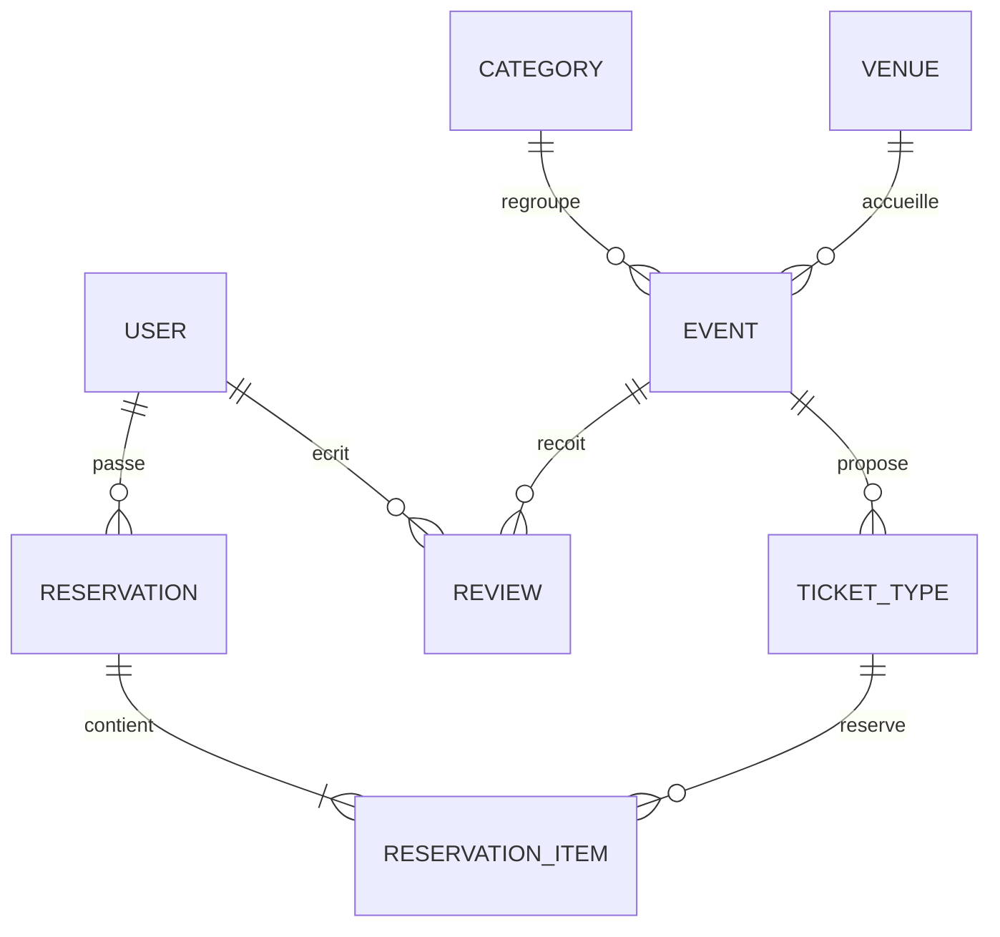

# Projet Symfony – EventHub (billetterie et réservation d'événements)

Équipe (3 personnes, donc **6 entités minimum avec CRUD**, sans compter `User`) :
**Ahmed Mnakbi**, **Saker Fradi**, **Khaled Lourimi**

## 1. Pourquoi le thème « Events »

- Il est autorisé en équipe. Hôtel, Resto, Cabinet et Agence sont limités à 2 personnes.
- La réservation est au cœur du sujet : places, types de billets, capacité, statut.
- L'upload obligatoire tombe naturellement sur l'affiche de l'événement.
- Les statistiques sont faciles à rendre intéressantes : CA, billets vendus, taux de remplissage, top événements.
- Le travail se découpe proprement en 3 parties, et chacun présente la sienne à la démo.

> Comme l'équipe a 3 membres, **les bundles admin (EasyAdmin…) sont interdits**. Le dashboard admin est donc fait à la main, avec Twig et Bootstrap.

## 2. Stack technique

| Élément | Choix |
|---|---|
| Framework | **Symfony 7.4 LTS** (compatible avec le PHP 8.2 de XAMPP) |
| Base de données | MariaDB 10.4 (XAMPP), Doctrine ORM + Migrations |
| Front | Twig + Bootstrap 5 (AssetMapper, sans Node) + Chart.js pour les stats |
| Upload | Service `FileUploader` maison (Slugger + contraintes `Image`) |
| Données de test | DoctrineFixturesBundle + Faker |
| Pagination | KnpPaginatorBundle |
| Sécurité HTTP | NelmioSecurityBundle (en-têtes CSP, X-Frame-Options…) |
| Hébergement (gratuit) | alwaysdata (PHP + MySQL gratuits), ou Render / Railway |

## 3. Modélisation des entités

| # | Entité | Champs principaux | Relations |
|---|---|---|---|
| – | **User** | email, password (hashé), roles, firstName, lastName, phone, isActive, createdAt | 1–N Reservation, 1–N Review |
| 1 | **Category** | name, slug, description | 1–N Event |
| 2 | **Venue** (Lieu) | name, address, city, capacity | 1–N Event |
| 3 | **Event** | title, slug, description, image (**upload**), startAt, endAt, status (brouillon/publié/annulé), createdAt | N–1 Category, N–1 Venue, 1–N TicketType, 1–N Review |
| 4 | **TicketType** | name (Standard, VIP…), price, quantity, sold | N–1 Event, 1–N ReservationItem |
| 5 | **Reservation** | reference (unique), status (en attente/confirmée/annulée), total, createdAt | N–1 User, 1–N ReservationItem |
| 6 | **ReservationItem** | quantity, unitPrice | N–1 Reservation, N–1 TicketType |
| 7 | **Review** (bonus) | rating (1-5), comment, createdAt, isApproved | N–1 User, N–1 Event |

Cela fait 6 entités obligatoires, plus `Review` en marge de sécurité.

Règles métier :
- On ne peut pas réserver plus que `quantity - sold` pour un type de billet. Le contrôle se fait au checkout, dans une transaction.
- Si une réservation est annulée, les places sont remises en vente (`sold` diminue).
- Un client ne voit que ses propres réservations, ce qu'impose un **Voter**.
- Seul un client qui a une réservation confirmée pour un événement peut laisser un avis.

## 4. Fonctionnalités par rapport au cahier des charges

**Admin (`/admin`, accès `ROLE_ADMIN`)**
1. CRUD Category, Venue, Event (avec upload d'affiche) et TicketType
2. Gestion des réservations : liste, filtres, détail, changement de statut
3. Gestion des clients : liste, recherche, activer/désactiver, voir leurs réservations
4. Statistiques : CA total et mensuel, billets vendus, top 5 des événements, taux de remplissage, nouveaux clients (Chart.js)
5. Modération des avis (bonus)

**Client**
1. Inscription, connexion, déconnexion, page « Mon compte » avec modification du profil et du mot de passe
2. « Mes réservations » : liste, détail, annulation si l'événement n'a pas encore eu lieu
3. Catalogue avec recherche et filtres : mot-clé, catégorie, ville, période, prix max, tri, pagination
4. Panier en session, avec plusieurs types de billets et plusieurs événements, puis validation qui crée la Reservation
5. Avis sur les événements (bonus)

## 5. Sécurité (XSS, injection SQL, CSRF…)

| Menace | Mesure |
|---|---|
| XSS | Auto-échappement Twig, jamais de `|raw` sur une saisie utilisateur, en-têtes CSP via NelmioSecurityBundle |
| Injection SQL | Doctrine ORM et QueryBuilder avec paramètres liés uniquement, aucune concaténation SQL |
| CSRF | Tokens CSRF sur tous les formulaires Symfony, plus `isCsrfTokenValid()` sur les boutons supprimer, annuler et panier |
| Authentification | Mots de passe hashés (auto/bcrypt), `login_throttling`, remember-me, vérification `isActive` |
| Autorisations | `access_control` sur `/admin`, `#[IsGranted]`, Voter `ReservationVoter` |
| Upload | Contrainte `Image` (mimeTypes, maxSize 2 Mo), nom de fichier aléatoire et slugifié, stockage hors du code source |
| Validation | Contraintes `Assert` sur toutes les entités, `UniqueEntity` sur l'email |
| Production | `APP_ENV=prod`, `APP_DEBUG=0`, `APP_SECRET` fort, `.env.local` hors de git, pages d'erreur personnalisées |

## 6. Répartition du travail (chacun commite ses parties)

| Membre | Responsabilités |
|---|---|
| **Ahmed Mnakbi** | Initialisation du projet et du dépôt git, User et sécurité (inscription, login, compte, rôles, throttling, Nelmio), layouts front et admin, CRUD Category et Venue, déploiement |
| **Saker Fradi** | Event (upload) et TicketType (CRUD admin), catalogue client avec recherche, filtres et pagination, page détail, Review et modération |
| **Khaled Lourimi** | Panier en session, checkout vers Reservation et ReservationItem, « Mes réservations » et ReservationVoter, gestion admin des réservations et des clients, dashboard de statistiques |

Workflow git : une branche `main` protégée, une branche par fonctionnalité (`feature/auth`, `feature/events`…), une Pull Request par fonctionnalité, et des commits signés au nom de chaque membre.

## 7. Étapes pas à pas

0. **Environnement** : activer `intl`, `gd`, `zip`, `sodium` et `opcache` dans `C:\xampp\php\php.ini`, démarrer MySQL dans XAMPP, créer le dépôt GitHub et y inviter les 3 membres.
1. **Init** : `symfony new` (webapp, 7.4), configuration de la base dans `.env.local`, `git init`, premier commit.
2. **Auth** : `make:user`, inscription, login, logout, Mon compte, rôles, layouts Bootstrap front et admin.
3. **Category et Venue** : entités, migrations, CRUD admin.
4. **Event et TicketType** : entités, upload d'affiche, CRUD admin.
5. **Catalogue client** : liste, recherche et filtres, pagination, détail.
6. **Panier et réservation** : panier en session, checkout transactionnel, Mes réservations, annulation, Voter.
7. **Admin réservations et clients**.
8. **Avis** (bonus).
9. **Statistiques** : requêtes d'agrégation et Chart.js.
10. **Fixtures**, durcissement de la sécurité et pages d'erreur.
11. **Production et déploiement** : build prod, test responsive, hébergement gratuit.
