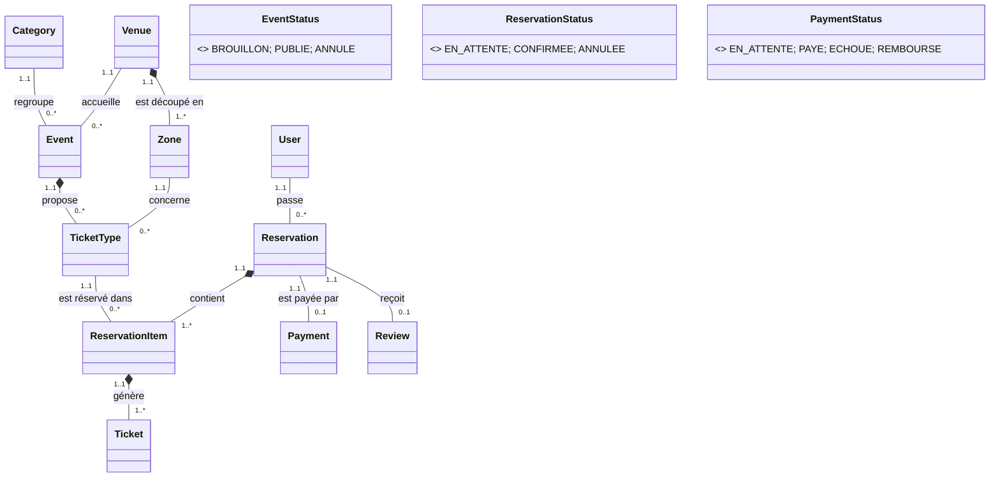

# Projet Symfony – EventHub (billetterie et réservation d'événements)

Équipe (3 personnes, donc **6 entités minimum avec CRUD**, sans compter `User`) :
**Ahmed Mnakbi**, **Saker Fradi**, **Khaled Lourimi**

## 1. Pourquoi le thème « Events »

- Il est autorisé en équipe. Hôtel, Resto, Cabinet et Agence sont limités à 2 personnes.
- La réservation est au cœur du sujet : places, types de billets, capacité, statut.
- L'upload obligatoire tombe naturellement sur l'affiche de l'événement.
- Les statistiques sont faciles à rendre intéressantes : CA, billets vendus, taux de remplissage, top événements.
- Le travail se découpe proprement en 3 parties, et chacun présente la sienne à la démo.

> Comme l'équipe a 3 membres, **les bundles admin (EasyAdmin…) sont interdits**. Le dashboard admin est donc fait à la main, avec Twig et Bootstrap.

## 2. Stack technique

| Élément | Choix |
|---|---|
| Framework | **Symfony 7.4 LTS** (compatible avec le PHP 8.2 de XAMPP) |
| Base de données | MariaDB 10.4 (XAMPP), Doctrine ORM + Migrations |
| Front | Twig + Bootstrap 5 (AssetMapper, sans Node) + Chart.js pour les stats |
| Upload | Service `FileUploader` maison (Slugger + contraintes `Image`) |
| Données de test | DoctrineFixturesBundle + Faker |
| Pagination | KnpPaginatorBundle |
| Sécurité HTTP | NelmioSecurityBundle (en-têtes CSP, X-Frame-Options…) |
| Hébergement (gratuit) | alwaysdata (PHP + MySQL gratuits), ou Render / Railway |

## 3. Modélisation des entités

> **Version 2**, après la correction du professeur (27/11/2026) :
> - plusieurs images par événement ;
> - ajout de **Zone** (découpage d'un lieu), **Ticket** (billet nominatif avec QR code et PDF) et **Payment** (Stripe) ;
> - suppression de `sold` dans TicketType : les billets vendus sont calculés à partir des réservations ;
> - statuts sous forme d'**énumérations** ;
> - l'avis est rattaché à la **réservation** : l'utilisateur et l'événement s'en déduisent ;
> - multiplicités notées en `min..max`.

| # | Entité | Champs principaux | Relations |
|---|---|---|---|
| – | **User** | email, password (haché), roles, firstName, lastName, phone, isActive, createdAt | 1..1 → 0..* Reservation |
| 1 | **Category** | name, slug, description, icon, createdAt | 1..1 → 0..* Event |
| 2 | **Venue** (lieu) | name, address, city, capacity, createdAt | 1..1 → 0..* Event, 1..1 ◆ 1..* Zone |
| 3 | **Zone** | name (Chaises, Pelouse, Gradins…), capacity | 1..1 → 0..* TicketType |
| 4 | **Event** | title, slug, description, **images** (plusieurs uploads), startAt, endAt, status «enumeration», createdAt | ◆ 0..* TicketType |
| 5 | **TicketType** | name (Standard, VIP…), price DECIMAL(10,2), quantity | N–1 Event, N–1 Zone, 1..1 → 0..* ReservationItem |
| 6 | **Reservation** | reference (unique), status «enumeration» (en attente / confirmée / annulée), total, createdAt | N–1 User, ◆ 1..* ReservationItem, 0..1 Payment, 0..1 Review |
| 7 | **ReservationItem** | quantity, unitPrice | N–1 TicketType, ◆ 1..* Ticket |
| 8 | **Ticket** | serialNumber (unique), qrCode, pdfFile | N–1 ReservationItem (zone déduite du type de billet) |
| 9 | **Payment** | stripeSessionId, amount, currency, status «enumeration», paidAt, createdAt | 1..1 Reservation |
| 10 | **Review** | rating (1 à 5), comment, isApproved, createdAt | 1..1 Reservation |

On compte 10 entités hors User, pour 6 exigées.

**Décisions prises :**

- **Zone :** chaque type de billet correspond à **une zone** du lieu. Par exemple, VIP → Chaises à 80 DT, Standard → Pelouse à 30 DT. La zone d'un ticket se déduit donc de son type de billet.
- **Réservation :** une réservation concerne **un seul événement**. Le panier se vide si l'on ajoute un billet d'un autre événement. L'avis et le paiement se rattachent donc sans ambiguïté à la réservation.
- **Ticket :** un ticket par place achetée, relié directement à ReservationItem. Une ligne « 3 × Standard » génère 3 tickets.
- **Images :** un tableau de noms de fichiers. La première image est l'affiche principale.

**Règles métier :**

- Un événement ne peut être publié que s'il a au moins un type de billet.
- La date de fin doit être après la date de début.
- La somme des capacités des zones ne dépasse pas la capacité du lieu.
- Pour un événement, les billets mis en vente dans une zone ne dépassent pas la capacité de cette zone.
- Un type de billet n'utilise qu'une zone du lieu de son événement. Le lieu d'un événement ne peut donc pas changer tant qu'il a des billets.
- Un lieu sans zone ne peut pas accueillir d'événement, et on ne supprime pas la dernière zone d'un lieu qui accueille des événements.
- **Vendus** = somme des quantités réservées dans les réservations non annulées. Places restantes = `quantity` − vendus. Le contrôle se fait au checkout, dans une transaction.
- Annuler une réservation remet ses places en vente, puisque les vendus sont calculés.
- On ne supprime pas un événement, un type de billet ou une zone qui a déjà des réservations.
- Un client ne voit que ses propres réservations, ce qu'impose un **Voter**.
- Un avis n'est possible que sur une réservation **confirmée**, avec un seul avis par réservation.

## 4. Fonctionnalités par rapport au cahier des charges

**Admin (`/admin`, accès `ROLE_ADMIN`)**
1. CRUD Category, Venue (et ses zones), Event (upload de plusieurs images) et TicketType (une zone par type)
2. Gestion des réservations : liste, filtres, détail, changement de statut
3. Gestion des clients : liste, recherche, activer/désactiver, voir leurs réservations
4. Statistiques : CA total et mensuel, billets vendus, top 5 des événements, taux de remplissage, nouveaux clients (Chart.js)
5. Modération des avis

**Client**
1. Inscription, connexion, déconnexion, page « Mon compte » avec modification du profil et du mot de passe
2. « Mes réservations » : liste, détail, annulation si l'événement n'a pas encore eu lieu
3. Catalogue avec recherche et filtres : mot-clé, catégorie, ville, période, prix max, tri, pagination
4. Panier en session pour **un seul événement** (plusieurs types de billets), validation qui crée la Reservation, paiement **Stripe** (mode test), puis génération des tickets (n° de série, QR code, PDF)
5. Avis sur une réservation confirmée

## 5. Sécurité (XSS, injection SQL, CSRF…)

| Menace | Mesure |
|---|---|
| XSS | Auto-échappement Twig, jamais de `|raw` sur une saisie utilisateur, en-têtes CSP via NelmioSecurityBundle |
| Injection SQL | Doctrine ORM et QueryBuilder avec paramètres liés uniquement, aucune concaténation SQL |
| CSRF | Tokens CSRF sur tous les formulaires Symfony, plus `isCsrfTokenValid()` sur les boutons supprimer, annuler et panier |
| Authentification | Mots de passe hashés (auto/bcrypt), `login_throttling`, remember-me, vérification `isActive` |
| Autorisations | `access_control` sur `/admin`, `#[IsGranted]`, Voter `ReservationVoter` |
| Upload | Contrainte `Image` (types MIME, 2 Mo, dimensions), nom de fichier aléatoire généré par le serveur, extension déduite du contenu, `.htaccess` qui interdit l'exécution |
| Paiement | Stripe Checkout (aucune donnée bancaire ne transite par notre serveur), confirmation par webhook signé, clés uniquement dans `.env.local` |
| Validation | Contraintes `Assert` sur toutes les entités, `UniqueEntity` sur l'email |
| Production | `APP_ENV=prod`, `APP_DEBUG=0`, `APP_SECRET` fort, `.env.local` hors de git, pages d'erreur personnalisées |

## 6. Répartition du travail (chacun commite ses parties)

| Membre | Responsabilités |
|---|---|
| **Ahmed Mnakbi** | Initialisation du projet et du dépôt git, User et sécurité (inscription, login, compte, rôles, throttling, Nelmio), layouts front et admin, CRUD Category et Venue, déploiement |
| **Saker Fradi** | Event (images) et TicketType (CRUD admin), catalogue client avec recherche, filtres et pagination, page détail, Review et modération |
| **Khaled Lourimi** | Panier en session, checkout vers Reservation et ReservationItem, paiement Stripe, tickets (QR code, PDF), « Mes réservations » et ReservationVoter, gestion admin des réservations et des clients, dashboard de statistiques |

Workflow git : une branche `main` protégée, une branche par fonctionnalité (`feature/auth`, `feature/events`…), une Pull Request par fonctionnalité, et des commits signés au nom de chaque membre.

## 7. Étapes pas à pas

0. **Environnement** : activer `intl`, `gd`, `zip`, `sodium` et `opcache` dans `C:\xampp\php\php.ini`, démarrer MySQL dans XAMPP, créer le dépôt GitHub et y inviter les 3 membres.
1. **Init** : `symfony new` (webapp, 7.4), configuration de la base dans `.env.local`, `git init`, premier commit.
2. **Auth** : `make:user`, inscription, login, logout, Mon compte, rôles, layouts Bootstrap front et admin.
3. **Category et Venue** : entités, migrations, CRUD admin. Les zones du lieu sont ajoutées dans la version 2.
4. **Event et TicketType** : entités, upload, CRUD admin. Version 2 : plusieurs images, une zone par type de billet, `sold` supprimé.
5. **Catalogue client** : liste, recherche et filtres, pagination, détail.
6. **Panier, réservation et paiement** : panier en session pour un seul événement, checkout transactionnel, paiement Stripe (test), tickets avec QR code et PDF, Mes réservations, annulation, Voter.
7. **Admin réservations et clients**.
8. **Avis** sur une réservation confirmée, avec modération.
9. **Statistiques** : requêtes d'agrégation et Chart.js.
10. **Fixtures**, durcissement de la sécurité et pages d'erreur.
11. **Production et déploiement** : build prod, test responsive, hébergement gratuit.
